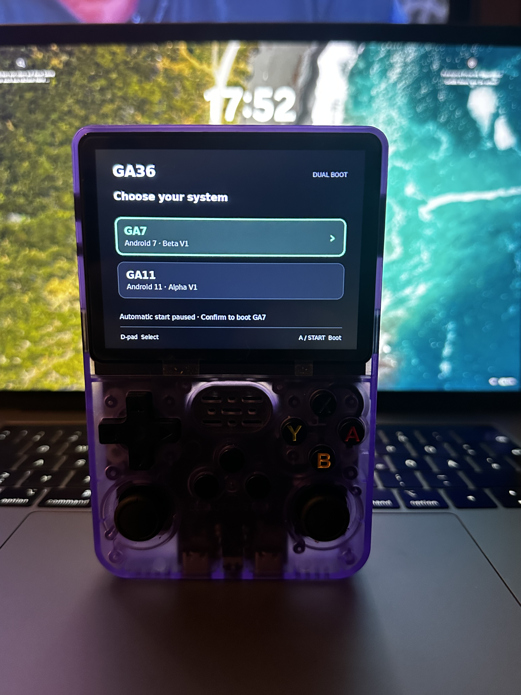
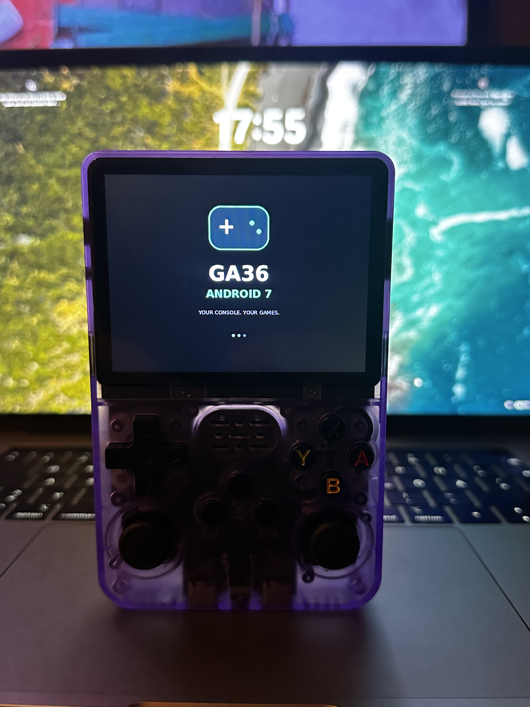
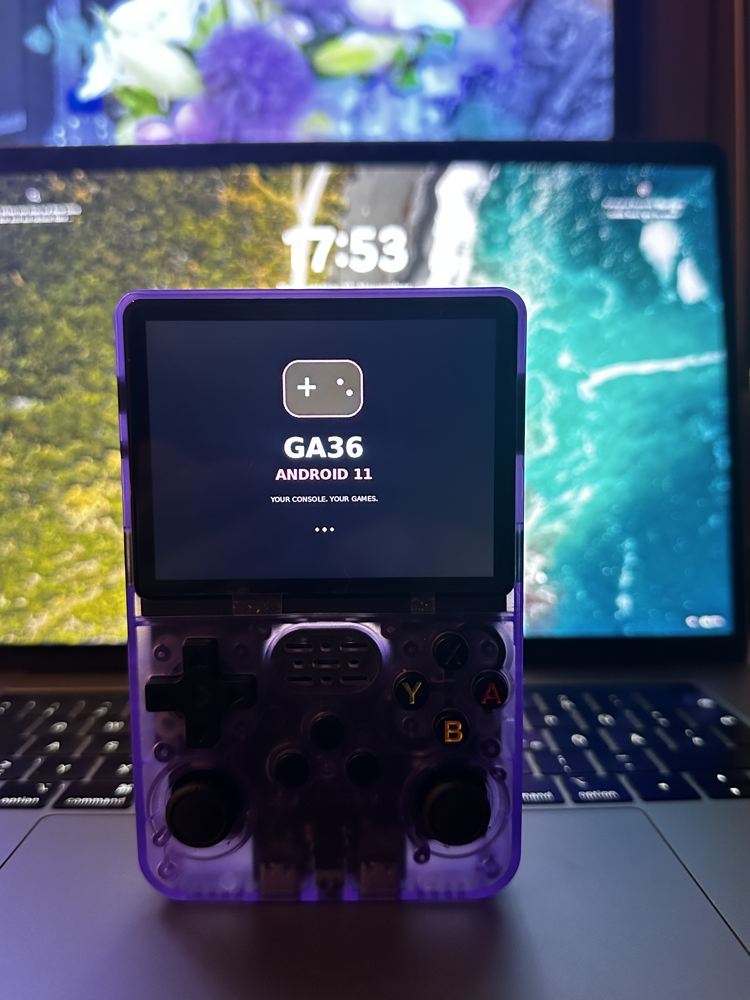
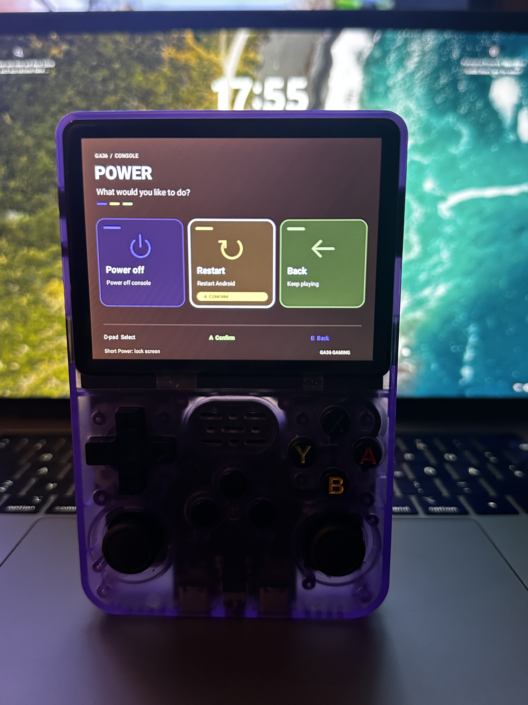
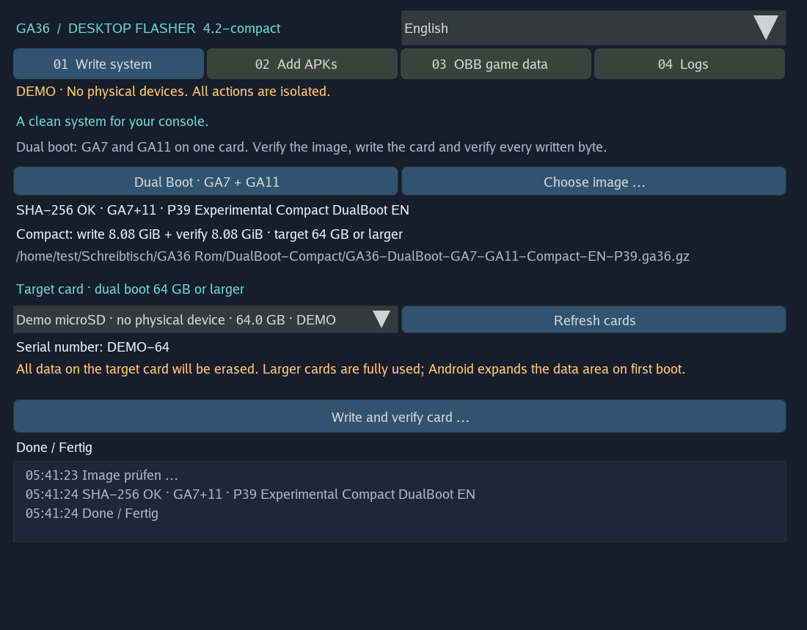

# R36S Clone — GA36-MB V1.2-20260416 — Android Releases

**EXPERIMENT — experimental GA7 / GA11 board port. GA7 Beta V1 / GA11 Alpha V1.**

Exact runtime platform: Allwinner A33, 512 MiB physical RAM. Compatibility
with ordinary R36S boards or other revisions is not established.

## Current dual-boot test

GA7 (Android 7 Beta V1) and GA11 (Android 11 Alpha V1) share the source-built
K11 #82 kernel. The clean English P39 dual image preserves the working boot
prefix and offsets, with fresh userdata and no games, accounts or saves.
ROMs, launcher, boot menu and animations default to English. The minimum
card holds 63,909,658,624 bytes: use 64 GB or larger. 256 MiB zRAM and shared
4 GiB SD swap do not increase the 512 MiB of physical RAM.

Latest owner report (12 November 2026): **both systems boot; GA7 audio works;
GA11 audio is intermittent**. Sleep/wake has bugs. Larger-card growth and stability tests remain open. USB/OTG and slot 2 are deferred. This is an experiment, not a
production-ready release. Separate GA7 and GA11 images are planned later.

## Downloads and components

[Download Dual Boot P39 — EXPERIMENTAL](https://github.com/Dirtyx686/R36S-Clone-GA36-Android-Releases/releases/tag/dualboot-p39-experimental)

Download the compact ROM, `IMAGE-INFOS.json` and the Linux flasher archive.
Keep the ROM and `IMAGE-INFOS.json` in the same directory. See
[flashing instructions](GA36Roms/DualBoot/README.md).

- [Linux desktop flasher 4.2 Compact](tools/flasher/README.md), DE/EN, with
  checksums, per-extent verification and readback. Public binary: Linux only.
- [GA36Roms](GA36Roms/README.md): board layout and metadata; no ROM binary in Git.
- [Current native dual bootstrap](src/native/dual-boot/README.md).
- [Launcher source](src/launcher/README.md), without bundled game logos/covers.
- [Kernel source/build metadata](src/kernel/README.md), plus the complete K11
  source archive listed in RELEASE-INDEX.json.
- [GA11 integration](GA36Roms/GA11/integration/README.md): 863 pinned projects
  and 13 projects with collected local modifications.
- [Driver provenance and license review](docs/licensing/README.md): exact
  file hashes, identified origins and component notices.

The compact package downloads less data and writes/reads about 8.67 GB each;
it keeps the 64-GB layout. It requires a compatible GA36 flasher. APK/OBB
queueing still requires the older GA36_APPS layout and is unavailable for
this new dual image. Windows remains a separate private test candidate.

## Device gallery

Photos from the owner’s GA36 test device. Sleep/wake and intermittent GA11
audio remain listed under known issues.

| GA7 boot screen | GA11 boot screen |
| --- | --- |
|  |  |

| Power menu | Linux flasher4.2 Compact (demo) |
| --- | --- |
|  |  |

[All device photos and system information](assets/photos/README.md)

## Sources and contribution

Read [CONTRIBUTING.md](CONTRIBUTING.md), component notices and
[KNOWN-ISSUES.md](KNOWN-ISSUES.md). Run `python3 tools/verify-source.py` to
verify the exact source selection. No private signing keys, ROM binaries,
game APKs/OBBs, accounts or saves are included. MIT covers original code only.

## Contribute and further develop

This is my first project of this kind. I am learning as I go, with AI assistance
and hands-on testing on my own handheld. Constructive feedback and help are welcome.

Everyone is welcome to contribute, fork and independently further develop the
project. Bug reports, device tests, fixes and improvements are welcome.
Original GA36 project code is MIT-licensed; third-party components retain their
respective licenses. See LICENSE, NOTICE.md and CONTRIBUTING.md.

## Deutsch

Dies ist mein erstes Projekt dieser Art. Ich lerne dabei mit KI-Unterstützung und
Tests am eigenen Gerät. Konstruktive Rückmeldungen und Hilfe sind willkommen.

Experiment für genau dieses GA36-Board. Beide Systeme starten laut letztem
Gerätetest; GA7 hat Ton, GA11 nur zeitweise. Sleep/Aufwecken hat Bugs. Linux-Flasher, Quellen und
Lizenzbeilagen sind enthalten. Jeder darf mitmachen, forken und das Projekt unter den jeweiligen Lizenzen
weiterentwickeln. Downloads: [dualboot-p39-experimental](https://github.com/Dirtyx686/R36S-Clone-GA36-Android-Releases/releases/tag/dualboot-p39-experimental).
