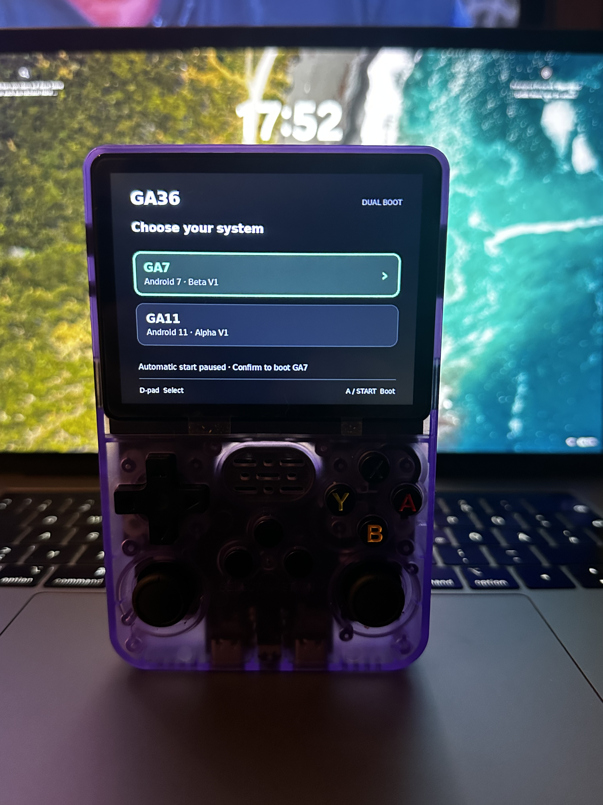
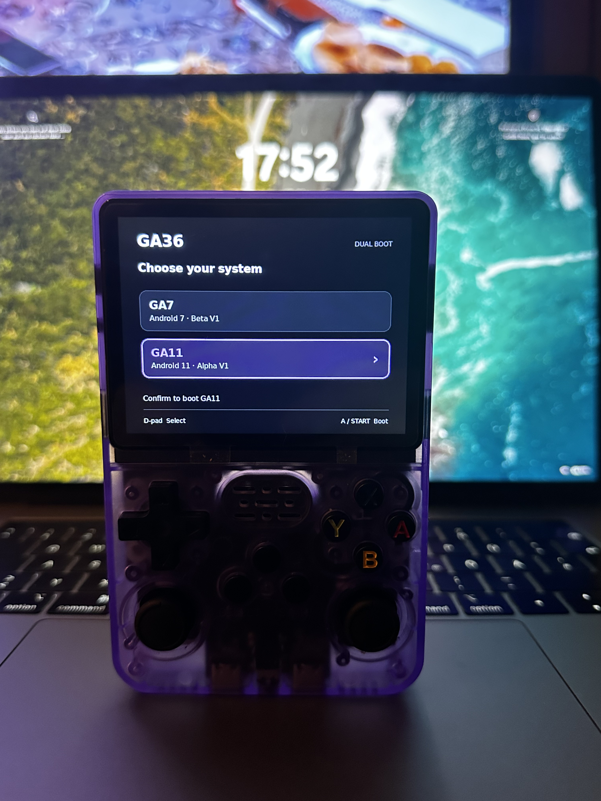
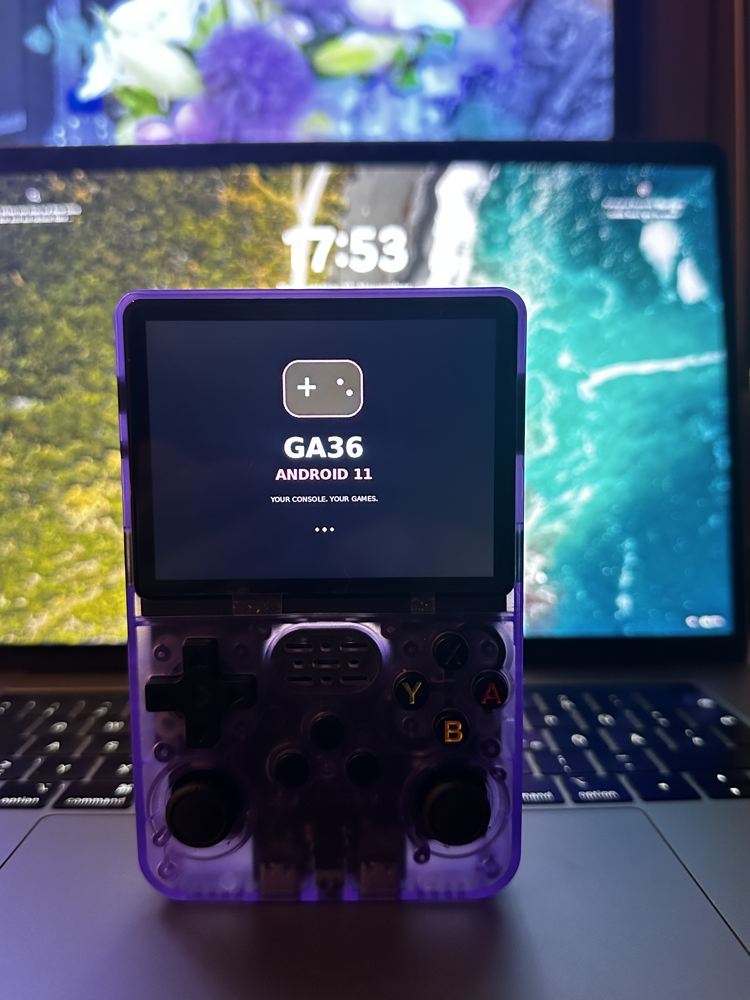
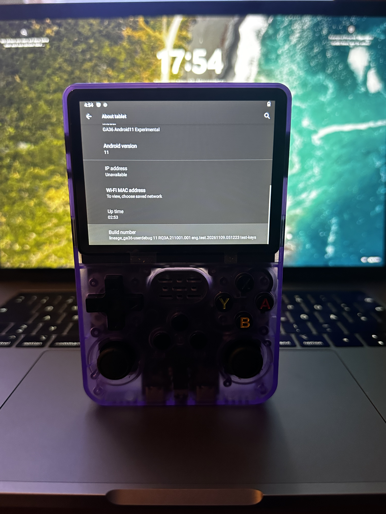
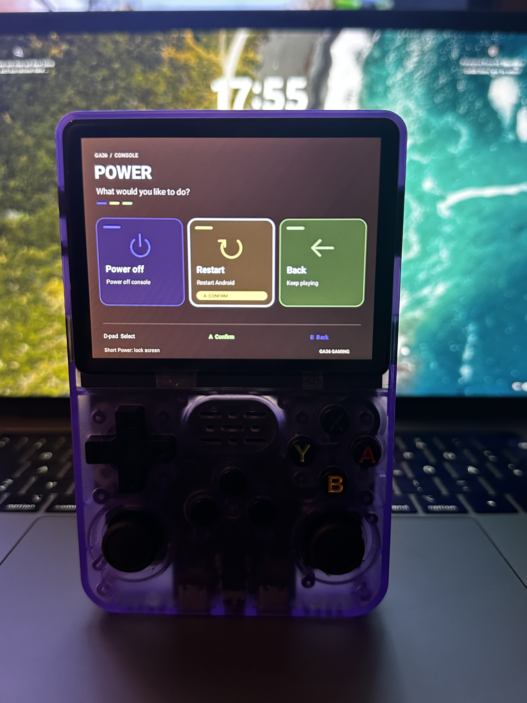
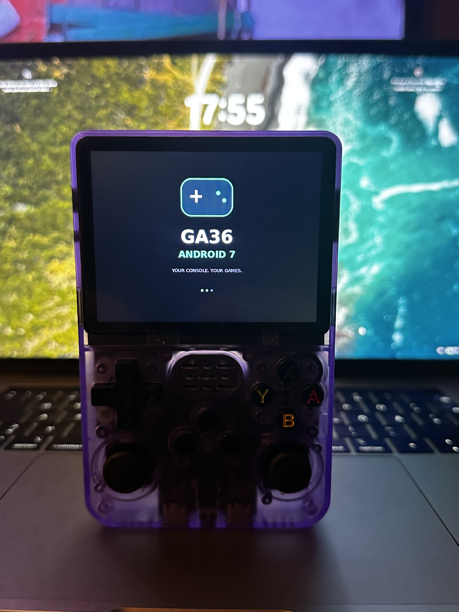
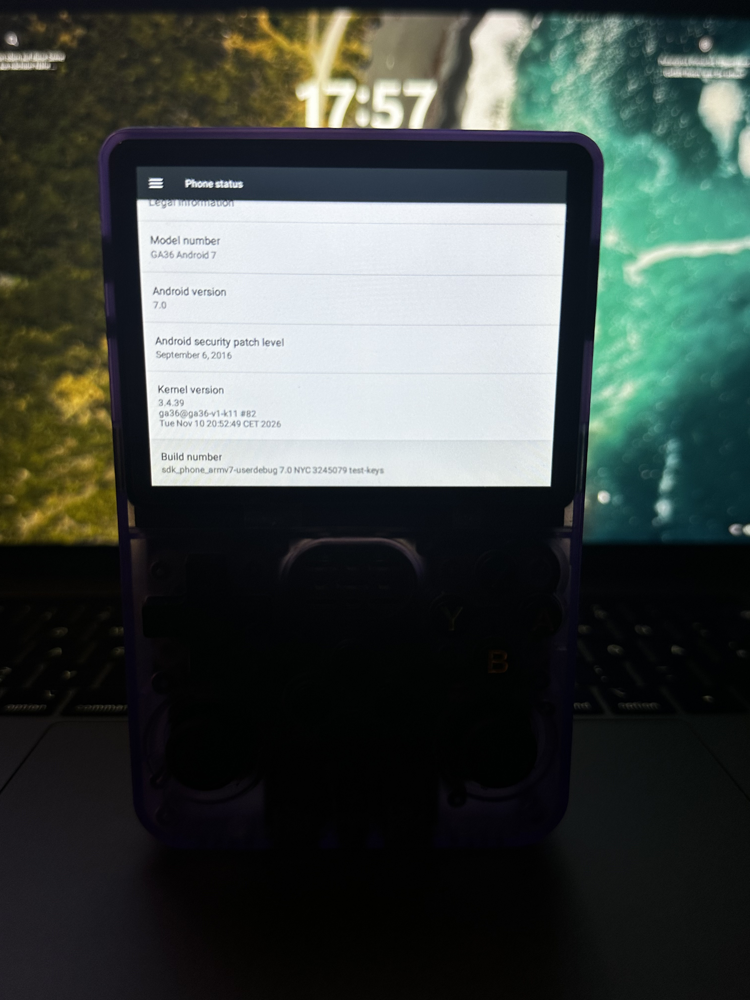

# Device photos / Gerätefotos

Photos supplied by the project owner. They show the owner’s GA36 test device. The photos document the visible interface; they do not establish that sleep/wake or audio are bug-free.

**Dual-boot menu: GA7 selected / Bootauswahl: GA7 markiert**

**Dual-boot menu: GA11 selected / Bootauswahl: GA11 markiert**

**GA11 boot screen / GA11-Startbild**

**Android11 device information / Android-11-Geräteinformationen**

**GA36 power and restart menu / GA36-Ausschaltmenü mit Neustart**

**GA7 boot screen / GA7-Startbild**

**Android7 with custom K11 kernel, build82 / Android7 mit eigenem K11-Kernel, Build82**

